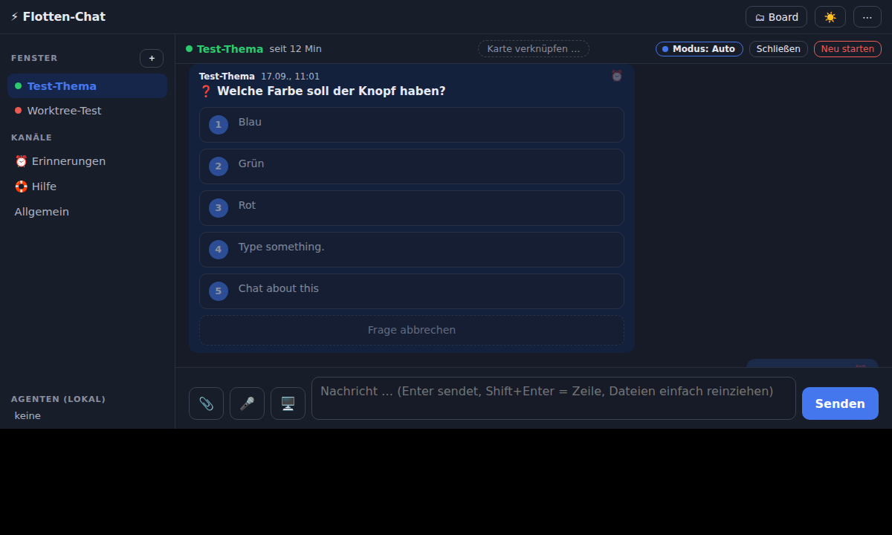

# Sales-Engine · Flotten-Chat 1.0

**Dein Claude-Code-Team im Handy-Chat.** Jedes Claude-Code-Fenster ist ein Kanal: du siehst es
arbeiten, es fragt dich mit Knöpfen, du gibst per Text, Bild oder Sprachnachricht Aufträge — und es
gibt **keine einzige Einstellung**. Ein Node-Server, eine SQLite-Datei, null npm-Dependencies
(Node ≥ 22.5, tmux, Claude Code).

> Entstanden im Live-Betrieb der [Sales-Engine](https://sales-engine.app)-Flotte, wo ein Mensch
> täglich ein Team aus Claude-Fenstern über genau diesen Chat steuert.



## Warum es keine Einstellungen gibt
Weil die KI die Einstellung ist. Du klonst das Repo, öffnest Claude Code darin und sagst **„let's go“**.
Claude liest die `CLAUDE.md`, prüft die Voraussetzungen, startet den Server, und du legst im Browser
deinen Zugang an (E-Mail + Passwort). Danach legst du Fenster an wie Chats. Kein Admin-Panel, kein JSON,
keine Rollen-Dateien.

Wir empfehlen und testen **Claude Code**. Andere Anbieter lassen sich andocken (`docs/adapter.md`) —
wer das baut, teilt es bitte (AGPL).

## Die fünf Momente
1. **Null-Settings-Start** — `node bin/flottenchat.mjs up`, ein Satz an Claude, fertig.
2. **Konsole im Chat** — Terminalbild und Protokoll des Fensters gespiegelt, vom Handy aus.
   Antworten, Rückfragen, Freigaben, Auto-Mode-Sperren: alles im Kanal.
3. **Knöpfe statt Rückfragen-Chaos** — eine `AskUserQuestion` wird zu Buttons, auch mehrstufig: Mehrfachauswahl
   mit Häkchen + eigener Antwort + „Weiter“, mehrere Fragen hintereinander, Absenden-Übersicht. Freigaben
   („darf ich …?“) tippst du weg wie eine WhatsApp-Antwort. „manual“/„auto“ schaltet den Modus des Fensters.
4. **Sprache rein, Bild raus** — Sprachnachricht im Chat → Auftrag; Antworten mit Screenshot, PDF,
   Video inline (Anhang-Bühne).
5. **Frische Fenster** — Kanal = Fenster = Thema. „Schließen“ lässt das Fenster seinen Stand
   wegschreiben, sichert Ungesichertes als WIP, räumt seinen Worktree auf — dann ist der Kanal weg.
   Kein Kontext-Müll.

Dazu: **Geräte koppeln** (Mac, Linux-Server, Laptop per Einmal-Code und Rückkanal — Fenster laufen dort
wie hier, siehe [docs/geraete.md](docs/geraete.md)), **Live-Terminal** im Kanal-Kopf (echtes Terminalbild + Tastenleiste), **Themen-Board** (Karte =
Thema, lose zu den Fenstern — Fenster schreiben ihren Stand in den Verlauf), **Erinnerungen** (feuern serverseitig ohne KI, „▶ Fenster“ kümmert sich),
**Alarm-Eingang** (`POST /api/alarm`), **Hilfe-Kanal** (Support-Brücke zum Hersteller).

Seit 1.1 außerdem: **Kanal-Verwaltung** („⋯" an der Zeile: Anzeigename, Reihenfolge per Drag & Drop oder ▲/▼,
Archiv, Stumm — gilt auf allen Geräten gleich), **Ungelesen-Zähler** je Kanal (Badge, Tab-Titel „(N)", Kanal öffnen =
gelesen, geräteübergreifend) und **Suche** über alle Kanäle (Lupe im Kopf oder Strg+K; alle Wörter müssen vorkommen,
Klick springt zur Nachricht, Esc schließt).

## Quickstart
```bash
git clone https://github.com/Hepposhesse/flotten-chat && cd flotten-chat
claude            # Claude Code im Repo öffnen
> let's go        # Claude richtet den Ort ein (Server, Dienst, erstes Fenster)
```
Oder von Hand: `node bin/flottenchat.mjs up` → `http://127.0.0.1:3900/` → Zugang anlegen → „＋ Fenster“.

## Betrieb (dauerhaft)
**Linux (systemd):**
```ini
# /etc/systemd/system/flotten-chat.service
[Unit]
Description=Sales-Engine Flotten-Chat
After=network.target
[Service]
WorkingDirectory=/pfad/zu/flotten-chat
Environment=FC_PORT=3900
# Environment=FC_CLAUDE_CONFIG_DIR=/home/du/.claude   # anderes Claude-Konto für die Fenster
# Environment=FC_DEFAULT_REPO=/pfad/zum/repo           # für den Worktree-Kehrdienst
ExecStart=/usr/bin/node bin/flottenchat.mjs up
Restart=on-failure
# Wichtig: nur der Node-Prozess stirbt beim Neustart — der tmux-Server mit den Fenstern lebt weiter.
KillMode=process
[Install]
WantedBy=multi-user.target
```
**macOS:** launchd-Plist mit demselben Befehl, oder einfach ein Terminal-Tab.
**Von außen (Handy):** nur hinter TLS-Proxy mit `FC_HOST=0.0.0.0` — siehe `docs/reverse-proxy.md`.
Login und Alarm-/Support-Eingänge sind gebremst (Rate-Limits), Medien-URLs sind unratbar.

## Wie die Konsole im Chat funktioniert
Alle drei Sekunden je Fenster: Terminalbild lesen (Modus, Dialog, beschäftigt?) → neue Zeilen des
Claude-Sitzungsprotokolls (`~/.claude/projects/…/<sitzung>.jsonl`) als Chat-Beiträge → offener Dialog
als Frage mit Knöpfen → neue Chat-Nachrichten des Menschen per `tmux send-keys` ins Fenster.
Das Fenster kennt den Chat nicht; es antwortet im Terminal. Details: `docs/konsole.md`.

**Orte:** `lokal` (tmux auf dem Chat-Server) oder `ssh:user@rechner` (dieselben Befehle über SSH — Mac,
zweiter Server; SSH-Key vorausgesetzt).

## Worktree-Hygiene
Ein Fenster mit „eigener Worktree“ arbeitet in `<repo>/worktrees/<name>` auf Branch `fc/<name>`.
„Schließen“ = 60 s Zeit zum Stand-Wegschreiben → Ungesichertes wird als WIP committet (nie gelöscht) →
Branch gepusht (wenn Remote da) → Session beendet → Worktree entfernt, wenn sauber. Verwaiste
Worktrees listet `GET /api/worktrees?repo=…`; entfernt wird nur, was sauber ist und kein laufendes
Fenster besitzt.

## API (Auszug, Bearer Admin-Token oder Login-Cookie)
`GET /api/fenster` · `POST /api/fenster {name, ordner|repo, ort, start_modus, start_text}` ·
`POST /api/fenster/<name>/(start|neustart|stop|schliessen|loeschen|tippen)` · `GET /api/fenster/<name>/terminal`, `POST …/tasten` ·
`GET/POST /api/karten`, `POST /api/karten/<id>/verlauf` ·
`GET/POST /api/reminders`, `POST /api/reminders/<id>/(erledigt|verschieben|session)` ·
`POST /api/send {kanal, inhalt, media?, client_id?}` · `GET /api/messages?kanal=&seit=` · `GET /api/events` (SSE) ·
`POST /api/alarm` (Header `x-fc-alarm-token`) · `POST /api/hilfe/antwort` (Header `x-fc-hilfe-token`) ·
`GET/POST /api/kanal-einstellungen {reihenfolge, archiviert, stumm, namen}` · `GET /api/unread` · `GET/POST /api/gelesen {kanal, bis, force?}` ·
`GET /api/search?q=` (max. 50 Treffer, nur sichtbare Kanäle).

## Regeln, die wir gelernt haben (und die das Produkt prägen)
- **Chat ist Absicht, Code ist Zustand.** Ein Fenster liest nie den Verlauf nach; sein Stand lebt an
  festen Orten (Karte, Repo, Memory). Nachrichten, die älter als 2 h sind, wenn ein Fenster
  wiederkommt, werden nicht nachgeliefert.
- **Themen statt Rollen.** Fenster sind wegwerfbar; Wissen liegt im Repo (CLAUDE.md), nicht im Fenster.
- **Die KI legt Karten nur auf Zuruf an** — vorhandene befüllt sie selbst.
- **Rückfragen sind Knöpfe.** Freitext-Fragen aus dem Fenster kommen zwar an, aber `AskUserQuestion`
  ist der Weg, der sich nach Chat anfühlt.

## Lizenz
AGPL-3.0 — siehe `LICENSE`. Beiträge: `CONTRIBUTING.md`. Sicherheit: `SECURITY.md`.
